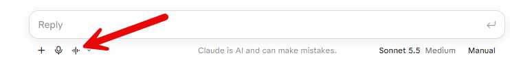

# Lingo Abroad

> **Like a language podcast or audio course, but it talks back.** 7-minute voice lessons inside Claude: the polite phrases you'll say, what locals say back, and the signs you'll see.

Lingo Abroad is a travel language course that runs as a **Claude skill**: no app to install, no account, no tracking. Any language to any language. Level 1 (survival for a first trip) has six topics: Basics, Understanding & Getting Help, Transport, Sightseeing, Restaurant and Shopping, 3 lessons and a test each. **[See what you'll learn →](COURSE.md)**

**Who it's for:** say you're heading to Italy in two weeks. You'd like to get by in Italian, but you don't want a gamified language app or a six-month course: just the phrases you'll actually need, a few minutes a day, in your earbuds. Lingo Abroad gives you a voice tutor who teaches you to order, ask for directions and catch what locals say back, then roleplays the waiter or the taxi driver so you can practice. **You choose the tutor:** laid-back like a friend who lives there, strict like a teacher before an exam, playful, a surprise each day, or your own character ("Nonna Rosa from Naples, strict but warm"). Lessons can be 5, 7 or 10 minutes, heavier on drills or on conversation: just say **"settings"**.

**How it's different:**
- **vs. language podcasts and audio courses:** the same earbuds-in format, but it waits for your answer, corrects you, and remembers what you find hard.
- **vs. gamified language apps:** no points or daily goals to chase; just the phrases for your trip, planned around your departure date.
- **vs. just asking an AI to teach you:** a real course: structured lessons, polite forms only, spaced review, tests and a progress card.

**Languages:** learn any language, explained in your own. By voice, it works best when both are among Claude's voice languages: currently English, Spanish, French, German, Italian, Portuguese (Portugal and Brazil), Chinese (Mandarin and Cantonese), Japanese, Korean, Hindi, Indonesian, Russian, Turkish and Ukrainian. In text, any language works.

Feedback and bugs: [Issues](https://github.com/ericpopivker/lingo-abroad/issues)

**Privacy:** Lingo Abroad has no server and collects nothing. Your progress lives only in your own Claude chats, as the progress card. Feedback goes nowhere unless you tap the GitHub link it gives you.

## Install and use (Claude)

### One-time setup

1. **Turn on files:** in Claude, **Settings → Capabilities → Create and edit files** (skills need it).
2. **Install the plugin:** **Customize → Plugins → Add marketplace** → `ericpopivker/lingo-abroad` → turn on **Sync automatically** → open **Lingo Abroad** in the plugin list → click **Add** (top right). Updates then arrive by themselves.
3. **Create a project named "Lingo Abroad"** and paste this into its **instructions** (it makes every chat in the project start Lingo Abroad on its own):
   > Every chat in this project is a Lingo Abroad lesson. You MUST load the Lingo Abroad skill before your first reply, whatever the message ("next lesson", "hi", "practice" or a pasted card). Never reply without it. Load it once per chat; don't reload it on later turns.

   On your phone, add the project to your home screen for one-tap lessons.
4. **First lesson:** in the project, **new chat** → pick **Opus** → type **"Start Lingo Abroad"** → when it says **"Lingo Abroad is loaded…"**, tap **Use voice mode** and say **"ready"** → answer the setup questions by voice.

> [!IMPORTANT]
> **Make sure it's really Lingo Abroad, not plain Claude.** They look alike: plain Claude will happily improvise a language lesson, but without the course, the polite-only rules, the review or your progress. You're in Lingo Abroad when:
> - the first reply is **"Lingo Abroad is loaded…"** (and the app shows a **"Loaded skill lingo-abroad"** step above it),
> - lessons open with a header like **"Lingo Abroad · Restaurant, Lesson 2"**,
> - every lesson ends with a **progress card**,
> - **"Lingo, version"** answers **"Lingo Abroad, version x.y.z"**.
>
> If not, or if Claude says the skill isn't available, stop and start a new chat (see **If something's wrong** below).

### Every lesson, practice or test: a new chat in your project

1. Open the **Lingo Abroad project** → **New chat**. Always a new one: faster and far fewer tokens than a long chat.
2. Pick **Opus**.
3. Tap **Use voice mode** and say **"Next lesson"** (or **"Practice"**, **"Basics test"**, **"Final test"**). No typing needed: the project starts Lingo Abroad on its own.
4. When it says **"Lingo Abroad is loaded…"**, say **"ready"**.

   

   In an open chat, **Use voice mode** is the waveform icon at the bottom left; the microphone next to it is dictation only.

5. **Listen to the first line:** it names the card it found ("Found your card from Nov 24: 7 of 18 lessons…"). If it's not your latest, or it can't find one, say where you are ("I finished Transport lesson 1") or paste your latest card.
6. Do the lesson (~7 minutes), hands-free. Say **"wait"** if you need a moment. Every lesson ends with your **progress card** in the chat.

Works best in the Claude **phone and desktop apps**. On the web, voice works but pauses ("Let me check…") before every answer.

**Without the project** (or if it can't find your card): open any new chat, **paste your latest progress card** (copy it from the end of your last lesson) and send it; then **"Lingo Abroad is loaded…"** → voice → **"ready"**.

### Things you can say

**To start** (in a new chat in your project, or after pasting your card):
- **"Ready"**: the next lesson
- **"Practice"**: a review of your shaky phrases (or **"practice the last lesson"**)
- **"Restaurant lesson 2"** (any lesson name): jump to that lesson, even out of order
- **"Quick one"**: a 2-minute review on a busy day
- **"Freestyle"**: a free chat in the language, after a few lessons
- **"Basics test"** (any topic) or **"Final test"**: type it under the card before sending (tests can't load once you're in voice). The final test covers all of Level 1 once you've passed the six topic tests.

**During a lesson:**
- **"Wait"**: take a moment
- **"Slower"**: hear it again, slowly
- **"Another way"**: a different memory trick
- **"What does … mean?"** · **"How do I say …?"**: ask anything; your own phrases get saved and practiced

**Anytime in a Lingo Abroad chat** (in a fresh chat, start with **"Lingo, …"**, e.g. **"Lingo, help"**):
- **"Progress"** · **"Stats"** · **"Plan"**: where you are, how you're doing, and a schedule to your trip
- **"Card"**: show your progress card
- **"Settings"**: change your tutor, the lesson length (5, 7 or 10 minutes), memory tricks and more
- **"Change my trip"** · **"Switch to Spanish"**: a new destination or date, or another language
- **"I'm back"**: after the trip, a short debrief
- **"Feedback"**: something wrong or an idea? Claude writes a short report and a link to send it
- **"Help"** · **"Version"**

### If something's wrong

| What you see | What to do |
| :--- | :--- |
| No **"Lingo Abroad is loaded"**, or a general answer about the language | The skill didn't load. Check you're on **Opus**, start a new chat and paste the card again (its first line, "▶ Use skill: Lingo Abroad…", starts the skill). |
| "Let me check…" / "I'm working on it" before every answer | Usual on the web. Use the Claude phone or desktop app for quick back-and-forth. |
| It misheard you, or answers something else | Say it again, slowly. |
| In voice: "I need to load that first" | End the call and start again from step 1. |
| Lost your latest card | Start a new chat, type **"Lingo Abroad"** and say where you are: **"I finished Transport lesson 1, 7 of 18 lessons."** |
| Not sure you have the latest version | Say **"Lingo, version"**: it answers "Lingo Abroad, version x.y.z". |

### Good to know

- **Opus works best.** Sonnet usually works too (handy on a free account), but it sometimes doesn't load the skill or drifts from the lesson; if that happens, start a new chat and try again. Haiku isn't supported.
- **Usage:** one new chat per lesson keeps usage down. (On Claude Free with Sonnet we measured roughly 1 lesson + 1 practice per 5-hour window.)
- **Quick questions** ("plan", "stats", "how do I say…") are fine in the same chat; every new lesson, practice or test gets a new chat.
- **Tests:** pass = 8/10 and polite answers in the roleplay.
- **Optional progress sheet:** say **"log row"** after a lesson and paste the row into your own Google Sheet/Excel built from [templates/](templates/) (`progress-log.csv`, setup and formulas in `progress-sheet.md`).

## How it works

| Term | Meaning |
| :--- | :------ |
| **Level** | A course for one stage of travel. Level 1 = survival for a first trip (6 topics × 3 lessons = 18 lessons). |
| **Topic** | A subject area: Basics, Understanding & Getting Help, Transport, Sightseeing, Restaurant, Shopping. |
| **Lesson** | One 7-minute daily sitting: recall → speak & listen → read → roleplay → progress card. |
| **Topic test / Level final test** | Pass/fail checks (8/10 and 12/15, polite register required) that earn **Passed ✓**. |
| **Progress card** | A short text block Claude writes into the chat at the end of every lesson; the learner pastes it into a new chat to start the next lesson, practice or test (in Claude Code it can also save it to a file if you ask). |

Every lesson has three parts: **Speak** (what you say, always polite), **Listen** (what locals say back) and **Read** (signs and menus). Review uses three buckets (**Weak / Learning / Solid**) ordered by list position only, so the AI never has to do date math.

## Learning science behind it

Lingo Abroad borrows proven pieces from six methods—trimmed down to fit a 7-minute voice lesson:

- **Pimsleur (Graduated-Interval Recall & Anticipation):** Model a new phrase slowly first, repeat it, then recall the one before the last one (~30–60s gap) and again in the roleplay—zero grammar lectures, polite register by default.
- **Atomic Habits (James Clear):** Habit-stacking cue (*"after morning coffee"*), visible trip countdown, a 2-minute **"quick one"** recall session for busy days, and **never miss twice** (easy win after a skipped day, zero guilt).
- **Anki / Leitner Spaced Repetition:** Retrieval-first prompts (answer before seeing/hearing the phrase), interleaving across topics, and an LLM-safe **3-bucket** queue (`Weak` → `Learning` → `Solid`)—plus Anki-style **again / easy** overrides in Practice mode.
- **Comprehensible Input (Krashen, *i+1*):** Every lesson trains **Listen** separately with realistic local replies slightly above what you produce, paired with a low-anxiety English safety net mid-roleplay.
- **Keyword Mnemonics:** Short, accurate memory tricks (word parts, cognates, or sound-alike pictures) tailored to the learner's own native language—or saved when the learner invents their own.
- **Shadowing (Voice Mode):** Light echo-repeat after hearing the tutor model each phrase aloud to build rhythm and mouth muscle memory.

## For maintainers

Requires Python 3 (standard library only).

```bash
python build.py          # check versions, build dist/lingo-abroad-claude.zip
python build.py --bump   # bump the patch version in plugin.json + marketplace.json, then build
```

Release: `python build.py --bump`, commit, push. Claude installs that have the marketplace with **Sync automatically** pick it up.
